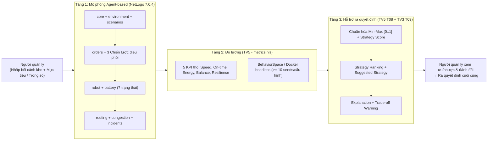

# Hợp đồng Kỹ thuật DSS — T02 (`docs/dss-contract.md`)

> **Trạng thái:** Bản đặc tả chính thức cho Task **T02** (`22/11 → 23/11/2026`)  
> **Người chủ trì (Owner):** TV5 – Phạm Đăng Khôi (`docs/t02-dss-flow-contract`)  
> **Mục đích:** Tài liệu hợp đồng duy nhất (**Single Source of Truth**) khóa câu hỏi quyết định, 3 chiến lược điều phối, 5 KPI, Data Dictionary chuẩn **NetLogo 7.0.4** và Procedure Contract cho đủ 12 module `.nls` trước khi triển khai `T03–T08`.

---

## 1. Câu hỏi ra quyết định, Phạm vi & Luồng DSS 3 tầng

### 1.1. Câu hỏi ra quyết định trung tâm
> *“Với bối cảnh vận hành kho hiện tại (số lượng robot, tốc độ phát sinh đơn, tỷ lệ đơn ưu tiên, mức tắc nghẽn, xác suất sự cố, cấu hình pin/sạc) và mục tiêu ưu tiên của người quản lý, chiến lược điều phối nào phù hợp nhất: **Nearest** (robot gần nhất), **Least workload** (robot ít tải nhất) hay **Multi-criteria** (đa tiêu chí) — và người quản lý cần chấp nhận đánh đổi gì?”*

### 1.2. Nguyên tắc cốt lõi của đồ án
- **Cân bằng 50% Mô phỏng Agent-based – 50% Hỗ trợ ra quyết định (DSS)**: Robot và đơn hàng là tác tử mô phỏng hậu quả; trọng tâm sản phẩm là so sánh công bằng các phương án, chuẩn hóa KPI, xếp hạng, giải thích lý do và chỉ ra đánh đổi.
- **Khuyến nghị chỉ mang tính tham khảo**: Hệ thống không tự động ép buộc phương án. `Suggested Strategy`, `Explanation` và `Trade-off Warning` đóng vai trò thông tin đầu vào; **người quản lý là người đưa ra quyết định cuối cùng**.
- **Quy tắc so sánh công bằng**: Cả 3 chiến lược bắt buộc chạy trên cùng cấu trúc bản đồ kho, cùng tham số đầu vào bối cảnh, cùng tập `sim-seed` và cùng giới hạn `sim-max-ticks`.

### 1.3. Luồng DSS 3 tầng



---

## 2. Hợp đồng 3 Chiến lược điều phối (Tầng 1 — Dispatching)

Hệ thống triển khai chính thức **3 chiến lược** (đồng bộ với `README.md` mục 6). Mọi chiến lược chỉ xét tập ứng viên từ `available-robots` (những robot đang ở trạng thái `"idle"` và không gặp lỗi/đang sạc/pin dưới ngưỡng an toàn). Nếu `available-robots` rỗng, đơn tiếp tục chờ ở hàng đợi.

### 2.1. Chiến lược 1: `Nearest` (`basic-strategies.nls` — TV3)
- **Quy tắc chọn**: Chọn robot `r` trong `available-robots` có khoảng cách đến `pickup-patch` của đơn hàng `o` nhỏ nhất (`distance pickup-patch`).
- **Tie-break (hòa điểm)**: Nếu hai robot bằng khoảng cách, chọn robot có `who` nhỏ hơn để đảm bảo tính lặp lại theo `sim-seed`.
- **Thế mạnh / Đánh đổi dự kiến**: Đi rỗng ngắn, tốc độ và năng lượng tốt khi kho thông thoáng; dễ dồn cục gây tắc nghẽn và mất cân bằng tải khi cao điểm hoặc sự cố.

### 2.2. Chiến lược 2: `Least workload` (`basic-strategies.nls` — TV3)
- **Quy tắc chọn**: Chọn robot `r` trong `available-robots` có tải công việc đã thực hiện `orders-done` nhỏ nhất.
- **Tie-break (hòa điểm)**: Chọn robot có khoảng cách đến `pickup-patch` nhỏ hơn; nếu vẫn bằng nhau thì chọn `who` nhỏ hơn.
- **Thế mạnh / Đánh đổi dự kiến**: Giữ chỉ số `Balance` cao và đồng đều tuổi thọ đội xe; đánh đổi quãng đường di chuyển rỗng dài hơn khiến `Speed` và `Energy` kém hơn trong điều kiện bình thường.

### 2.3. Chiến lược 3: `Multi-criteria` (`decision-engine.nls` — TV5)
Khớp cấu trúc 5 thành phần trong `README.md` mục 6.3, mỗi thành phần được chuẩn hóa Min-Max về `[0, 1]` trên tập `available-robots` ứng viên cho đơn `o` (càng gần `1` càng ưu tiên; nếu `max == min` thì gán `1.0`):

```text
score(r, o) =
    mc-w-distance   * distance_score(r, o)
  + mc-w-battery    * battery_score(r)
  + mc-w-workload   * workload_score(r)
  + mc-w-priority   * priority_score(r, o)
  + mc-w-congestion * congestion_score(r, o)
```

| Thành phần | Định nghĩa & Công thức chuẩn hóa trên tập `available-robots` | Ý nghĩa |
|---|---|---|
| `distance_score(r, o)` | Chuẩn hóa ngược Min-Max của `distance [pickup-patch] of o` (`(max_d - d) / (max_d - min_d)`) | Robot càng gần điểm lấy hàng càng cao điểm |
| `battery_score(r)` | Chuẩn hóa thuận Min-Max của `[battery] of r` (`(b - min_b) / (max_b - min_b)`) | Robot còn nhiều pin hơn được ưu tiên hơn |
| `workload_score(r)` | Chuẩn hóa ngược Min-Max của `[orders-done] of r` (`(max_w - w) / (max_w - min_w)`) | Robot ít tải hơn được ưu tiên hơn |
| `priority_score(r, o)` | Đo khả năng **kịp hạn của cặp `(r, o)`**: tính độ dư hạn `slack(r, o) = (deadline-tick - ticks) - estimated-trip-ticks(r, o)` (với `estimated-trip-ticks` = khoảng cách `r → pickup → delivery`). Nếu `priority = "high"` (hoặc đơn sắp quá hạn), chuẩn hóa thuận Min-Max của `slack(r, o)` trên các robot ứng viên; nếu `priority = "normal"`, gán `0.5` trung tính *(kết hợp xếp đơn `"high"` lên trước trong hàng đợi `orders.nls`)* | Khi có đơn khẩn, ưu tiên robot đủ khả năng giao kịp hạn thay vì robot quá xa hoặc kẹt |
| `congestion_score(r, o)` | Chuẩn hóa ngược Min-Max của `path-congestion (patch-of r) ([pickup-patch] of o)` | Tránh robot phải đi xuyên vùng đang đông đúc |

- **Tie-break (hòa điểm)**: Chọn robot có `who` nhỏ hơn.
- **Cơ chế ánh xạ trọng số theo mục tiêu quản lý + Ràng buộc chống áp đảo (`[0.10, 0.45]`, tổng = `1.00`)**:
  - Theo `README.md` mục 6.3, 5 trọng số điều phối `mc-w-*` thay đổi theo `management-goal` của người quản lý.
  - Để giữ đúng bản chất **đa tiêu chí** (không để `Multi-criteria` tự triệt tiêu về thành `Nearest` hay `Least workload` khi kéo một trọng số lên 100%, đồng thời bảo toàn đánh đổi Pareto thật trong mô phỏng), mọi `mc-w-*` được ràng buộc nằm trong `[0.10, 0.45]` và tổng bằng `1.00`.
  - Khi người quản lý chọn chế độ **`Custom`** (kéo 5 thanh trượt KPI `w-speed .. w-resilience`), hệ thống tính ánh xạ xác định:
    1. Chuẩn hóa 5 slider KPI về `(u_spd, u_ont, u_ene, u_bal, u_res)` có tổng `1.0`.
    2. Tính thành phần thô theo ngữ nghĩa vận hành:  
       `raw_dist = 0.7 * u_spd + 0.3 * u_ene`  
       `raw_bat  = u_ene`  
       `raw_load = u_bal`  
       `raw_prio = u_ont`  
       `raw_cong = 0.5 * u_res + 0.3 * u_spd + 0.2 * u_ont`
    3. Áp dụng phép kẹp lồi trong `[0.14, 0.44]` (nằm trọn trong `[0.10, 0.45]`) mà vẫn đảm bảo tổng luôn bằng `1.00`:  
       `mc_i = 0.14 + 0.30 * (raw_i / sum(raw))`

---

## 3. Hợp đồng 5 KPI, Chuẩn hóa & Mô hình chấm điểm chiến lược (Tầng 2 — DSS)

### 3.1. Bộ 5 KPI cốt lõi (`metrics.nls` — TV5)

| # | Trục mục tiêu | Reporter chính (`metrics.nls`) | Công thức chính xác | Đơn vị | Chiều tốt | Xử lý biên (khi mẫu = 0) |
|---|---|---|---|---|---|---|
| 1 | **Speed** | `kpi-avg-completion-time` | Trung bình `(completed-tick - created-tick)` của tất cả đơn có `order-status = "completed"` | `ticks/đơn` | **Thấp hơn tốt hơn (`min`)** | Nếu chưa hoàn thành đơn nào: trả về `sim-max-ticks` |
| 2 | **On-time** | `kpi-ontime-rate` | `(total-orders-ontime / count orders with (order-status = "completed" or ticks > deadline-tick)) * 100` *(tính cả đơn quá hạn còn tồn để tránh bỏ đơn khó nhằm làm đẹp tỷ lệ)* | `% (0–100)` | **Cao hơn tốt hơn (`max`)** | Nếu chưa có đơn hoàn thành hoặc quá hạn: trả về `100.0` |
| 3 | **Energy** | `kpi-energy-per-order` | `total-energy-consumed / total-orders-completed` | `đv pin/đơn` | **Thấp hơn tốt hơn (`min`)** | Nếu `total-orders-completed = 0`: trả về `total-energy-consumed` (hoặc `9999` nếu có đơn chờ chưa giao) |
| 4 | **Balance** | `kpi-load-balance` | `max(0, 1 - (standard-deviation [orders-done] of robots / mean [orders-done] of robots))` | `0..1` | **Cao hơn tốt hơn (`max`)** | Nếu `mean = 0` hoặc `count robots <= 1`: trả về `1.0` |
| 5 | **Resilience** | `kpi-resilience` | `0.5 * completion-ratio + 0.5 * uptime-ratio`, trong đó:<br/>• `completion-ratio = total-orders-completed / max(1, total-orders-created)`<br/>• `uptime-ratio = 1 - ((total-wait-ticks + total-broken-ticks) / max(1, count robots * ticks))`<br/>*(khi có sự cố thu hồi đơn, theo dõi thêm `kpi-recovery-rate = total-reassigned-completed / max(1, total-orders-reassigned)` cho phân tích)* | `0..1` | **Cao hơn tốt hơn (`max`)** | Nếu `ticks = 0` hoặc `total-orders-created = 0`: trả về `1.0` |

**Các reporter phụ phục vụ Monitor, Plot & BehaviorSpace CSV**:
- `kpi-completed-orders`: số đơn hoàn thành (`total-orders-completed`).
- `kpi-pending-orders`: số đơn chưa hoàn thành (`count orders with [order-status != "completed"]`).
- `kpi-late-rate`: tỷ lệ đơn trễ (`100 - kpi-ontime-rate`, `%`).
- `kpi-total-energy`: tổng năng lượng tiêu thụ (`total-energy-consumed`).
- `kpi-avg-wait-time`: thời gian chờ trung bình mỗi robot (`total-wait-ticks / max(1, count robots)`).
- `kpi-total-charges`: tổng số lần sạc (`sum [charge-count] of robots`).
- `kpi-congestion-events`: tổng tick chờ do tắc nghẽn (`total-wait-ticks`).
- `kpi-recovery-rate`: tỷ lệ hoàn thành các đơn bị sự cố thu hồi (`%`).

### 3.2. Chuẩn hóa KPI & Công thức Strategy Score (`decision-engine.nls` — TV5)
Sau khi chạy đủ 3 chiến lược trên cùng cấu hình và `sim-seed`:
1. **Chuẩn hóa Min-Max về `[0, 1]`** cho từng KPI `k` trong 5 KPI trên tập 3 giá trị `{v_Nearest, v_Least, v_Multi}`:
   - Nếu `max_k == min_k` (cả 3 chiến lược đạt kết quả bằng nhau): gán **`norm_k = 1.0`** (tuyệt đối không chia cho `0`).
   - Nếu KPI chiều **càng cao càng tốt** (`On-time`, `Balance`, `Resilience`): `norm_k(i) = (v_k(i) - min_k) / (max_k - min_k)`.
   - Nếu KPI chiều **càng thấp càng tốt** (`Speed`, `Energy`): `norm_k(i) = (max_k - v_k(i)) / (max_k - min_k)`.
2. **Chuẩn hóa 5 trọng số KPI** `(w-speed, w-ontime, w-energy, w-balance, w-resilience)` thành `(w1, w2, w3, w4, w5)` sao cho `w1 + w2 + w3 + w4 + w5 = 1.0` (nếu tổng cả 5 slider bằng `0`, mặc định chia đều mỗi trọng số `0.20`).
3. **Tính điểm tổng hợp**:
   ```text
   Strategy Score(i) = w1 * norm_Speed(i)
                     + w2 * norm_OnTime(i)
                     + w3 * norm_Energy(i)
                     + w4 * norm_Balance(i)
                     + w5 * norm_Resilience(i)
   ```
4. **Xếp hạng**: Sắp xếp 3 chiến lược theo `Strategy Score` giảm dần để cập nhật `strategy-ranking` và `recommended-strategy`.

### 3.3. Bảng 6 Preset Mục tiêu Quản lý (`management-goal`)

| `management-goal` | Trọng số KPI `(w1, w2, w3, w4, w5)` | Trọng số điều phối `Multi-criteria` `(dist, bat, load, prio, cong)` | Mục đích sử dụng |
|---|---|---|---|
| `"Balanced"` | `(0.20, 0.25, 0.20, 0.15, 0.20)` | `(0.20, 0.20, 0.20, 0.20, 0.20)` | Cân bằng tổng thể các tiêu chí |
| `"Fast Delivery"` | `(0.45, 0.25, 0.10, 0.10, 0.10)` | `(0.40, 0.15, 0.10, 0.20, 0.15)` | Ưu tiên giao hàng nhanh nhất |
| `"Minimize Late Orders"` | `(0.20, 0.45, 0.05, 0.15, 0.15)` | `(0.20, 0.15, 0.10, 0.40, 0.15)` | Giảm tỷ lệ đơn trễ hạn & đơn ưu tiên |
| `"Save Energy"` | `(0.10, 0.15, 0.50, 0.15, 0.10)` | `(0.30, 0.35, 0.10, 0.10, 0.15)` | Tiết kiệm năng lượng tiêu thụ trên mỗi đơn |
| `"Load Balance"` | `(0.10, 0.15, 0.15, 0.50, 0.10)` | `(0.15, 0.20, 0.40, 0.10, 0.15)` | San đều tải công việc cho đội robot |
| `"Incident Resilience"` | `(0.10, 0.20, 0.10, 0.15, 0.45)` | `(0.15, 0.25, 0.15, 0.15, 0.30)` | Tối ưu phục hồi khi tắc nghẽn / robot hỏng |
| `"Custom"` | Đọc trực tiếp từ 5 slider `w-*` | Ánh xạ theo công thức `0.14 + 0.30 * p_i` ở mục 2.3 | Người quản lý tự chỉnh trọng số |

*(Ghi chú: Tổng mỗi hàng KPI = `1.00`; tổng mỗi hàng `Multi-criteria` = `1.00` và mọi thành phần nằm trong `[0.10, 0.45]`.)*

---

## 4. Data Dictionary chuẩn NetLogo 7.0.4

> **Quy tắc NetLogo bắt buộc:**
> 1. Toàn bộ `breed`, `globals`, `patches-own`, `robots-own`, `orders-own` được khai báo **tập trung duy nhất trong `model/WarehouseRobot.nlogox`** để cả 12 file `.nls` dùng chung không bị trùng lặp.
> 2. Các biến tạo từ **Slider / Chooser / Switch trên Interface** tự động là biến toàn cục ngầm định trong NetLogo — **TUYỆT ĐỐI KHÔNG khai báo lại trong khối `globals [...]`**.

### 4.1. Biến Interface (Inputs trên UI & BehaviorSpace)

| Tên biến | Kiểu Widget | Miền / Giá trị hợp lệ | Mặc định | Ý nghĩa |
|---|---|---|---|---|
| `scenario-preset` | Chooser | `"Normal"`, `"Peak"`, `"Congestion"`, `"Incidents"` | `"Normal"` | Preset kịch bản vận hành |
| `active-strategy` | Chooser | `"Nearest"`, `"Least workload"`, `"Multi-criteria"` | `"Nearest"` | Chiến lược chạy đơn lẻ |
| `num-robots` | Slider | `2` – `20` (bước `1`) | `8` | Số lượng robot trong kho |
| `order-spawn-rate` | Slider | `0.05` – `1.00` (bước `0.05`) | `0.25` | Xác suất sinh đơn mỗi tick |
| `priority-order-ratio` | Slider | `0.00` – `0.80` (bước `0.05`) | `0.20` | Tỷ lệ đơn ưu tiên (`"high"`) |
| `initial-battery` | Slider | `30` – `100` (bước `5`) | `100` | Mức pin khởi tạo (`%`) |
| `charge-rate` | Slider | `1.0` – `10.0` (bước `0.5`) | `4.0` | Tốc độ sạc pin mỗi tick (`%/tick`) |
| `congestion-level` | Slider | `0.0` – `1.0` (bước `0.1`) | `0.2` | Độ nhạy/hệ số cản trở tắc nghẽn |
| `incident-prob` | Slider | `0.00` – `0.10` (bước `0.005`) | `0.01` | Xác suất phát sinh sự cố mỗi tick |
| `sim-max-ticks` | Slider | `100` – `1000` (bước `50`) | `300` | Số tick kết thúc 1 lượt chạy |
| `sim-seed` | Slider / Input | `1` – `9999` (bước `1`) | `1` | Seed ngẫu nhiên dùng chung khi so sánh |
| `management-goal` | Chooser | `"Balanced"`, `"Fast Delivery"`, `"Minimize Late Orders"`, `"Save Energy"`, `"Load Balance"`, `"Incident Resilience"`, `"Custom"` | `"Balanced"` | Mục tiêu ưu tiên của người quản lý |
| `w-speed` | Slider | `0` – `100` (bước `5`) | `20` | Trọng số thô mục tiêu Speed |
| `w-ontime` | Slider | `0` – `100` (bước `5`) | `25` | Trọng số thô mục tiêu On-time |
| `w-energy` | Slider | `0` – `100` (bước `5`) | `20` | Trọng số thô mục tiêu Energy |
| `w-balance` | Slider | `0` – `100` (bước `5`) | `15` | Trọng số thô mục tiêu Balance |
| `w-resilience` | Slider | `0` – `100` (bước `5`) | `20` | Trọng số thô mục tiêu Resilience |

### 4.2. Biến `globals [...]` nội bộ (tách 3 nhóm vòng đời)

| Nhóm | Tên biến | Kiểu | Reset khi `setup-for-strategy`? | Mô tả |
|---|---|---|---|---|
| **Điều khiển & MC** | `model-status` | String | Có (`"Ready"`/`"Running"`/`"Done"`) | Trạng thái mô hình (giữ tương thích `experiments.xml` smoke-test) |
| | `is-comparing?` | Boolean | Không (do `run-comparison` quản lý) | Cờ báo đang chạy chuỗi so sánh 3 chiến lược |
| | `current-run-seed` | Number | Không (gán theo `seed-val`) | Seed đang dùng cho lượt chạy hiện tại |
| | `mc-w-distance`, `mc-w-battery`, `mc-w-workload`, `mc-w-priority`, `mc-w-congestion` | Number | Không (cập nhật từ `apply-goal-weights`) | 5 trọng số nội bộ đã chuẩn hóa cho `Multi-criteria` |
| **Tích lũy KPI lượt chạy** | `total-orders-created` | Number | **Có** (về `0`) | Tổng số đơn được sinh ra trong lượt chạy |
| | `total-orders-completed` | Number | **Có** (về `0`) | Tổng số đơn hoàn thành giao hàng |
| | `total-orders-ontime` | Number | **Có** (về `0`) | Số đơn hoàn thành với `completed-tick <= deadline-tick` |
| | `total-orders-late` | Number | **Có** (về `0`) | Số đơn hoàn thành trễ hoặc vượt hạn giao |
| | `total-energy-consumed` | Number | **Có** (về `0`) | Tổng đơn vị pin toàn đội robot đã tiêu thụ |
| | `total-wait-ticks` | Number | **Có** (về `0`) | Tổng tick robot phải đứng chờ (`"waiting"`) |
| | `total-broken-ticks` | Number | **Có** (về `0`) | Tổng tick robot ở trạng thái hỏng (`"broken"`) |
| | `total-incidents-triggered` | Number | **Có** (về `0`) | Tổng số sự cố khóa đường / hỏng robot đã xảy ra |
| | `total-orders-reassigned` | Number | **Có** (về `0`) | Số lần đơn bị thu hồi và phân công lại |
| | `total-reassigned-completed` | Number | **Có** (về `0`) | Số đơn từng bị thu hồi nhưng vẫn hoàn thành |
| **Kết quả DSS** | `comparison-results` | List | **KHÔNG reset** | Bảng KPI thô của 3 chiến lược trong `run-comparison` |
| | `normalized-results` | List | **KHÔNG reset** | Bảng điểm KPI đã chuẩn hóa `[0..1]` của 3 chiến lược |
| | `strategy-ranking` | List | **KHÔNG reset** | Danh sách xếp hạng theo `Strategy Score` giảm dần |
| | `recommended-strategy` | String | **KHÔNG reset** | Tên chiến lược khuyến nghị tham khảo đứng đầu |
| | `recommendation-reason` | String | **KHÔNG reset** | Nội dung giải thích định lượng (TV3 sinh từ `decision-summary-data`) |
| | `trade-off-warning` | String | **KHÔNG reset** | Cảnh báo đánh đổi & sát điểm (TV3 sinh từ `decision-summary-data`) |
| | `decision-summary-data` | List | **KHÔNG reset** | Gói dữ liệu chuẩn hóa do `T08` xuất cho `T09` (xem Mục 6) |

### 4.3. `patches-own` (Môi trường kho — `environment.nls` & `congestion.nls`)

| Tên thuộc tính | Kiểu & Giá trị hợp lệ | Mô tả |
|---|---|---|
| `patch-type` | `"aisle"`, `"shelf"`, `"pickup"`, `"packing"`, `"charger"`, `"waiting-zone"` | Loại ô trên lưới bản đồ kho |
| `is-blocked?` | Boolean (`true`/`false`) | Ô lối đi có đang bị sự cố khóa hay không |
| `blocked-until` | Number (tick) | Tick tự động mở khóa lại (`0` nếu không khóa) |
| `congestion-score` | Number (`>= 0`) | Chỉ số mật độ/tắc nghẽn tức thời trên patch |

### 4.4. `breed [ robots robot ]` & `robots-own` (`robot.nls` & `battery.nls`)

| Tên thuộc tính | Kiểu & Giá trị hợp lệ | Mô tả |
|---|---|---|
| `robot-state` | `"idle"`, `"assigned"`, `"to-pickup"`, `"carrying"`, `"waiting"`, `"charging"`, `"broken"` | Máy trạng thái 7 trạng thái của agent robot |
| `battery` | Number (`0` – `100`) | Phần trăm pin hiện tại |
| `energy-used` | Number (`>= 0`) | Tổng năng lượng robot này đã tiêu thụ |
| `current-order` | Agent `order` hoặc `nobody` | Đơn hàng robot đang nhận hoặc đang chở |
| `target-patch` | `patch` hoặc `nobody` | Điểm đến hiện tại (điểm lấy, đóng gói, sạc, chờ) |
| `orders-done` | Number (`>= 0`) | Số đơn robot đã giao xong (thước đo tải công việc) |
| `distance-traveled` | Number (`>= 0`) | Tổng số bước/ô robot đã di chuyển |
| `wait-ticks` | Number (`>= 0`) | Tổng số tick robot ở trạng thái `"waiting"` |
| `active-ticks` | Number (`>= 0`) | Tổng số tick robot hoạt động có ích |
| `charge-count` | Number (`>= 0`) | Số lần robot vào trạm sạc |
| `broken-until` | Number (tick) | Tick phục hồi từ trạng thái `"broken"` |
| `wait-streak` | Number (`>= 0`) | Số tick kẹt liên tiếp (kích hoạt đổi tuyến ở `routing.nls`) |

**Quy ước màu hiển thị trạng thái & Quy tắc chuyển trạng thái biên (TV2 + TV4)**:
- Màu gợi ý trên View: `idle` (`gray`), `assigned` / `to-pickup` (`blue`), `carrying` (`cyan`/`green`), `waiting` (`orange`), `charging` (`lime`), `broken` (`red`).
- **Ngưỡng pin**: Ngưỡng pin thấp `20%`, ngưỡng pin sạc đầy `95%`.
  - Khi robot đang `"idle"` mà `battery < 20`: tự động gọi `send-to-charger` → chuyển `"charging"`.
  - Khi robot đang `"assigned"` / `"to-pickup"` / `"carrying"` mà `battery <= 20` nhưng `> 0`: **giao nốt đơn hiện tại** rồi mới đi sạc (trừ khi hết pin về `0`).
  - Nếu `battery = 0` giữa đường: chuyển `"broken"` (kẹt hết pin), thu hồi đơn bằng `release-order` và phục hồi dần / đưa về sạc khi hết thời gian khắc phục.
  - Khi `incidents.nls` kích hoạt `break-robot [r duration]`: đặt `robot-state = "broken"`, đặt `broken-until = ticks + duration`, nếu `current-order != nobody` thì gọi `release-order current-order` và xóa `current-order = nobody`. Khi `ticks >= broken-until`, chuyển về `"idle"` (hoặc đi sạc nếu `battery < 20`).

### 4.5. `breed [ orders order ]` & `orders-own` (`orders.nls`)

| Tên thuộc tính | Kiểu & Giá trị hợp lệ | Mô tả |
|---|---|---|
| `order-status` | `"waiting"`, `"assigned"`, `"picked"`, `"completed"` | Vòng đời xử lý của đơn hàng |
| `priority` | `"normal"`, `"high"` | Mức độ ưu tiên của đơn |
| `created-tick` | Number | Tick phát sinh đơn |
| `deadline-tick` | Number | Hạn giao (`created-tick + slack`, đơn `"high"` có `slack` ngắn hơn) |
| `completed-tick` | Number (`-1` nếu chưa xong) | Tick bàn giao thành công tại khu `"packing"` |
| `pickup-patch` | `patch` | Ô lấy hàng trên kệ |
| `delivery-patch` | `patch` | Ô đóng gói / giao hàng |
| `assigned-robot` | Agent `robot` hoặc `nobody` | Robot đang phụ trách đơn |
| `was-reassigned?` | Boolean (`true`/`false`) | Đánh dấu đơn từng bị thu hồi do sự cố/hết pin để đo phục hồi |

### 4.6. Khối khai báo mẫu chuẩn cho `model/WarehouseRobot.nlogox` (TV1 tích hợp ở `T03`)

```netlogo
breed [ robots robot ]
breed [ orders order ]

globals [
  model-status
  is-comparing?
  current-run-seed
  mc-w-distance
  mc-w-battery
  mc-w-workload
  mc-w-priority
  mc-w-congestion
  total-orders-created
  total-orders-completed
  total-orders-ontime
  total-orders-late
  total-energy-consumed
  total-wait-ticks
  total-broken-ticks
  total-incidents-triggered
  total-orders-reassigned
  total-reassigned-completed
  comparison-results
  normalized-results
  strategy-ranking
  recommended-strategy
  recommendation-reason
  trade-off-warning
  decision-summary-data
]

patches-own [
  patch-type
  is-blocked?
  blocked-until
  congestion-score
]

robots-own [
  robot-state
  battery
  energy-used
  current-order
  target-patch
  orders-done
  distance-traveled
  wait-ticks
  active-ticks
  charge-count
  broken-until
  wait-streak
]

orders-own [
  order-status
  priority
  created-tick
  deadline-tick
  completed-tick
  pickup-patch
  delivery-patch
  assigned-robot
  was-reassigned?
]
```

---

## 5. Procedure Contract cho toàn bộ 12 module `.nls`

Khớp chính xác 12 file được nạp trong `__includes` của [WarehouseRobot.nlogox](file:///d:/HK5/DSS/warehouse-robot-dss/model/WarehouseRobot.nlogox).

### 5.1. Yêu cầu tích hợp lõi & Bẫy `clear-all` (`core.nls` — TV1)
- **Tắt cuốn biên bản đồ ở `T03`**: Trong [WarehouseRobot.nlogox](file:///d:/HK5/DSS/warehouse-robot-dss/model/WarehouseRobot.nlogox), cần chỉnh `wrappingAllowedX="false"` và `wrappingAllowedY="false"` để robot không đi xuyên tường từ mép kho này sang mép đối diện.
- **Hai hàm khởi tạo tách biệt để tránh `clear-all` xóa mất kết quả so sánh**:
  1. `to setup`: Dùng cho nút **Setup** (hoặc BehaviorSpace chạy đơn). Gọi `clear-all`, khởi tạo bảng DSS rỗng, gọi `apply-scenario-preset scenario-preset`, `apply-goal-weights`, `setup-environment`, `setup-robots`, `reset-metrics`, đặt `model-status "Ready"`, `reset-ticks`.
  2. `to setup-for-strategy [ strat seed-val ]`: **Reset mềm** dùng riêng trong vòng lặp `run-comparison`. Chỉ gọi `clear-turtles`, `clear-patches`, `clear-drawing`, `clear-all-plots`, `reset-ticks`, thiết lập `random-seed seed-val`, `set active-strategy strat`, đặt lại các biến tích lũy KPI, gọi `setup-environment`, `setup-robots`, `reset-metrics` — **không gọi `clear-all`** nên `comparison-results` và trọng số người dùng vẫn được giữ nguyên qua 3 lượt chạy.
- **Thứ tự bắt buộc trong `to go`**:
  ```netlogo
  to go
    if ticks >= sim-max-ticks [
      set model-status "Done"
      stop
    ]
    set model-status "Running"
    generate-orders
    update-incidents
    assign-unassigned-orders
    update-congestion
    update-robots
    update-orders
    update-metrics
    tick
  end
  ```

### 5.2. Bảng chữ ký công khai 12 Module `.nls`

| File `.nls` (Owner) | Procedure / Reporter công khai | Loại & Tham số | Đầu ra / Tác dụng | Module gọi |
|---|---|---|---|---|
| **`core.nls`** (TV1) | `setup` | `to` | Khởi tạo toàn mô hình từ đầu (`clear-all`) | Interface / BehaviorSpace |
| | `go` | `to` | Chạy 1 tick đúng thứ tự 8 bước | Interface / BehaviorSpace |
| | `reset-model` | `to` | Gọi lại `setup` và reset trạng thái UI | Interface |
| | `setup-for-strategy` | `to [ strat seed-val ]` | Reset mềm cùng `seed-val` cho 1 chiến lược | `decision-engine.nls` |
| | `validate-configuration` | `to-report` → boolean | Kiểm tra hợp lệ tham số đầu vào | `core.nls` |
| | `run-single-strategy-to-end` | `to [ strat seed-val ]` | Chạy `setup-for-strategy` rồi lặp `go` đến `sim-max-ticks` | `decision-engine.nls` |
| **`environment.nls`** (TV1) | `setup-environment` | `to` | Dựng lưới kho: kệ, lối đi, pickup, packing, trạm sạc, vùng chờ | `core.nls` |
| | `accessible-neighbors` | `to-report` (patch context) → patch-set | Trả về các patch lân cận `neighbors4` hợp lệ không phải `"shelf"` và `not is-blocked?` | `routing.nls` |
| | `random-pickup-patch` | `to-report` → patch | Chọn ngẫu nhiên 1 ô lấy hàng hợp lệ | `orders.nls` |
| | `random-packing-patch` | `to-report` → patch | Chọn ngẫu nhiên 1 ô đóng gói hợp lệ | `orders.nls` |
| | `nearest-charger-patch` | `to-report` (turtle context) → patch | Trả về trạm sạc gần nhất | `battery.nls` |
| **`scenarios.nls`** (TV1) | `apply-scenario-preset` | `to [ preset-name ]` | Áp dụng bộ tham số tương ứng 4 kịch bản preset | `core.nls` / Interface |
| **`robot.nls`** (TV2) | `setup-robots` | `to` | Sinh `num-robots` tại lối đi/vùng chờ hợp lệ với `initial-battery` | `core.nls` |
| | `available-robots` | `to-report` → turtle-set | Tập robot `robot-state = "idle"` và `not is-low-battery?` | `basic-strategies.nls`, `decision-engine.nls` |
| | `assign-task` | `to [ ord ]` (robot context) | Gán đơn `ord` cho robot `self`, đặt `robot-state = "assigned"`, cập nhật `target-patch` | `orders.nls` |
| | `update-robots` | `to` | Thực thi máy trạng thái 7 trạng thái cho mọi robot mỗi tick | `core.nls` |
| | `update-robot-visuals` | `to` (robot context) | Cập nhật màu, nhãn pin/trạng thái trực quan trên View | `robot.nls` |
| **`battery.nls`** (TV2) | `consume-battery` | `to [ amount ]` (robot context) | Trừ `battery`, cộng `energy-used` và `total-energy-consumed` | `robot.nls` |
| | `is-low-battery?` | `to-report` (robot context) → boolean | Trả về `true` nếu `battery < 20` | `robot.nls` |
| | `send-to-charger` | `to` (robot context) | Đặt `target-patch = nearest-charger-patch`, chuyển `"charging"` | `robot.nls` |
| | `charge-battery` | `to` (robot context) | Tăng pin theo `charge-rate` khi đứng tại trạm sạc đến `>= 95` | `robot.nls` |
| **`orders.nls`** (TV3) | `generate-orders` | `to` | Sinh đơn mới theo `order-spawn-rate` và `priority-order-ratio` | `core.nls` |
| | `unassigned-orders` | `to-report` → list | Danh sách đơn `"waiting"` đã sắp xếp ưu tiên `"high"` trước, rồi `created-tick` tăng dần | `orders.nls` |
| | `assign-unassigned-orders` | `to` | Gọi chiến lược theo `active-strategy` và gọi `assign-task` | `core.nls` |
| | `update-orders` | `to` | Cập nhật đơn trễ/tồn đọng mỗi tick | `core.nls` |
| | `release-order` | `to [ ord ]` | Trả đơn về `"waiting"`, `assigned-robot = nobody`, `was-reassigned? = true`, tăng `total-orders-reassigned` | `robot.nls`, `incidents.nls` |
| | `complete-order` | `to [ ord ]` | Đánh dấu `"completed"`, ghi `completed-tick`, cập nhật `total-orders-completed` / `ontime` / `late` / `reassigned-completed` | `robot.nls` |
| **`basic-strategies.nls`** (TV3) | `select-robot-nearest` | `to-report [ ord ]` → robot/nobody | Chọn robot gần `pickup-patch` nhất trong `available-robots` | `orders.nls` |
| | `select-robot-least-workload` | `to-report [ ord ]` → robot/nobody | Chọn robot có `orders-done` nhỏ nhất trong `available-robots` | `orders.nls` |
| **`routing.nls`** (TV4) | `next-step-toward` | `to-report [ dest-p ]` (robot context) → patch/nobody | Chọn ô hợp lệ tiếp theo từ `accessible-neighbors` tránh kệ/lối khóa/đông | `robot.nls` |
| | `move-robot-step` | `to` (robot context) | Di chuyển 1 bước tới `next-step-toward target-patch`; nếu kẹt chuyển `"waiting"` & tăng `wait-streak` | `robot.nls` |
| **`congestion.nls`** (TV4) | `update-congestion` | `to` | Tính `congestion-score` trên từng patch dựa trên mật độ robot & `congestion-level` | `core.nls` |
| | `path-congestion` | `to-report [ from-p to-p ]` → number | Ước lượng mức độ tắc nghẽn dọc tuyến giữa `from-p` và `to-p` | `decision-engine.nls`, `routing.nls` |
| **`incidents.nls`** (TV4) | `update-incidents` | `to` | Sinh sự cố ngẫu nhiên theo `incident-prob` và phục hồi sự cố hết hạn | `core.nls` |
| | `trigger-manual-incident` | `to` | Tạo nhanh 1 sự cố demo (hỏng 1 robot hoặc khóa 1 đoạn lối đi) | Interface (nút Demo TV4) |
| | `break-robot` | `to [ r duration ]` | Chuyển robot `r` sang `"broken"` và trả đơn qua `release-order` | `incidents.nls`, `robot.nls` |
| | `block-aisle-segment` | `to [ duration ]` | Đặt `is-blocked? = true` và `blocked-until` trên cụm patch lối đi | `incidents.nls` |
| **`metrics.nls`** (TV5) | `reset-metrics` | `to` | Đặt các biến tích lũy KPI lượt chạy về `0` | `core.nls` |
| | `update-metrics` | `to` | Cập nhật số liệu theo tick cho plots & reporters | `core.nls` |
| | 5 KPI reporters chính | `to-report` → number | `kpi-avg-completion-time`, `kpi-ontime-rate`, `kpi-energy-per-order`, `kpi-load-balance`, `kpi-resilience` | Interface, BehaviorSpace, `decision-engine.nls` |
| | `collect-current-kpi-snapshot` | `to-report` → list | Trả về list 6 phần tử: `[active-strategy kpi1 kpi2 kpi3 kpi4 kpi5]` | `decision-engine.nls` |
| **`decision-engine.nls`** (TV5 + TV3 `T09`) | `select-robot-multi-criteria` | `to-report [ ord ]` → robot/nobody | Chấm điểm 5 yếu tố + chọn robot cho chiến lược `Multi-criteria` | `orders.nls` |
| | `apply-goal-weights` | `to` | Cập nhật trọng số KPI & 5 trọng số `mc-w-*` theo `management-goal` | `core.nls`, `decision-engine.nls` |
| | `run-comparison` | `to` | Chạy đủ 3 chiến lược với cùng `sim-seed`, rồi gọi chuỗi DSS bên dưới | Interface (nút Run Comparison) |
| | `normalize-strategy-results` | `to` | Chuẩn hóa Min-Max `comparison-results` → `normalized-results` | `run-comparison` |
| | `calculate-strategy-scores` | `to` | Tính `Strategy Score` từng chiến lược theo trọng số quản lý | `run-comparison` |
| | `rank-strategies` | `to` | Sắp xếp `strategy-ranking`, gán `recommended-strategy` & đóng gói `decision-summary-data` | `run-comparison` |
| | `generate-recommendation` *(TV3 `T09`)* | `to` | Đọc `decision-summary-data` để điền `recommendation-reason` & `trade-off-warning` | `run-comparison` |

---

## 6. Hợp đồng bàn giao `T08` (TV5) → `T09` (TV3 — Explanation & Trade-off Warning)

Theo `Task_Chung.pdf`, `T09` của TV3 **không được tính lại KPI riêng**. Vì vậy `decision-engine.nls` (TV5) đóng gói toàn bộ kết quả dưới dạng danh sách NetLogo chuẩn (không cần extension bổ sung) để TV3 chỉ định dạng câu giải thích:

1. **`comparison-results`**: List gồm 3 phần tử theo chiến lược, mỗi phần tử dạng:  
   `[ strategy-name raw-speed raw-ontime raw-energy raw-balance raw-resilience ]`
2. **`normalized-results`**: List gồm 3 phần tử dạng:  
   `[ strategy-name norm-speed norm-ontime norm-energy norm-balance norm-resilience ]`
3. **`strategy-ranking`**: List đã sắp xếp giảm dần theo `Strategy Score` (`[ [rank1-name score1 ...] [rank2-name score2 ...] [rank3-name score3 ...] ]`).
4. **`decision-summary-data`**: List 9 phần tử cố định cho `generate-recommendation` đọc theo `item <index>`:
   - `item 0`: Tên chiến lược hạng 1 (`best-name`)
   - `item 1`: Điểm tổng hợp hạng 1 (`best-score`, làm tròn 3 chữ số)
   - `item 2`: Tên chiến lược hạng 2 (`second-name`)
   - `item 3`: Điểm tổng hợp hạng 2 (`second-score`)
   - `item 4`: Hiệu điểm `score-gap = best-score - second-score` (nếu `< 0.05` → TV3 bắt buộc chèn cảnh báo **sát điểm**)
   - `item 5`: Tên tiêu chí đóng góp `w_k * norm_k` lớn nhất của hạng 1 (ví dụ `"On-time"`)
   - `item 6`: Tên tiêu chí đóng góp lớn thứ 2 của hạng 1 (ví dụ `"Balance"`)
   - `item 7`: Chuỗi tóm tắt chênh lệch KPI thực tế giữa hạng 1 và hạng 2 trên 2 tiêu chí mạnh nhất
   - `item 8`: Danh sách các tiêu chí mà **hạng 1 kém hơn hạng 2 hoặc hạng 3** (mỗi mục `[kpi-name better-strategy delta]`; rỗng `[]` nếu không thua KPI nào)
5. **Quy tắc bắt buộc của `generate-recommendation` (TV3)**:
   - `recommendation-reason` phải nêu: **bối cảnh/mục tiêu hiện tại** + **chiến lược hạng 1 & điểm** + **2 tiêu chí đóng góp lớn nhất** + **chênh lệch định lượng so với hạng 2**.
   - `trade-off-warning` phải nêu **ít nhất 1 đánh đổi** từ `item 8` (hoặc chi phí vận hành/độ phức tạp nếu không thua KPI nào) + cảnh báo sát điểm nếu `score-gap < 0.05` + câu nhắc: *“Đây là khuyến nghị tham khảo; người quản lý sẽ xem xét các đánh đổi trên để ra quyết định cuối cùng.”*

---

## 7. Bảng tham số 4 Kịch bản Preset & Quy chuẩn thực nghiệm BehaviorSpace

Các giá trị dưới đây là cấu hình khởi điểm **`[ĐỀ XUẤT - CHỜ NHÓM CHỐT]`** cho `scenarios.nls` (TV1) và `experiments/experiments.xml` (TV5):

| Kịch bản (`scenario-preset`) | `num-robots` | `order-spawn-rate` | `priority-order-ratio` | `initial-battery` | `congestion-level` | `incident-prob` | `sim-max-ticks` | Mục đích kiểm chứng |
|---|---|---|---|---|---|---|---|---|
| **`Normal`** | `8` | `0.20` | `0.15` | `100` | `0.1` | `0.000` | `300` | Kiểm tra baseline khi kho thoáng |
| **`Peak`** | `8` | `0.55` | `0.35` | `100` | `0.3` | `0.005` | `300` | Áp lực đơn cao, đo đơn trễ & cân bằng tải |
| **`Congestion`** | `12` | `0.40` | `0.25` | `100` | `0.8` | `0.015` | `300` | Đông robot/khóa đường, đo chờ & tránh tắc |
| **`Incidents`** | `8` | `0.35` | `0.30` | `60` | `0.4` | `0.035` | `300` | Pin thấp & robot hỏng, đo phục hồi & tái phân công |

**Quy chuẩn chạy thí nghiệm BehaviorSpace & Docker (`T11`)**:
- Mỗi kịch bản × 3 chiến lược × **tối thiểu 10 lần lặp với cùng tập seed `sim-seed = 1..10`** (`4 × 3 × 10 = 120 runs`).
- Kết quả xuất CSV vào `experiments/results/`, tổng hợp **giá trị trung bình (mean)** và **độ dao động (stdev / min–max)** trước khi đưa vào báo cáo.

---

## 8. Bảng Sign-off Review 5 thành viên (Trước hạn 23/11/2026)

### Các mục gắn nhãn `[ĐỀ XUẤT - CHỜ NHÓM CHỐT]` cần review trên PR `T02`
1. **Cách tính `priority_score(r, o)` bằng độ dư hạn `slack(r, o)`** (Mục 2.3) và **công thức ánh xạ trọng số `Multi-criteria` có kẹp `[0.10, 0.45]`** (Mục 2.3 & 3.3).
2. **Công thức KPI `kpi-ontime-rate` và `kpi-resilience`** (Mục 3.1).
3. **Bộ tham số khởi điểm 4 kịch bản preset** (Mục 7).

### Checklist xác nhận của 5 thành viên

| Thành viên | Vai trò kiểm duyệt trong `T02` | Trạng thái |
|---|---|---|
| **TV1 – Trần Võ Thanh Ngân** | Xác nhận quy trình `setup` / `setup-for-strategy` (reset mềm tránh `clear-all`), `go` 8 bước, tắt wrapping bản đồ, chữ ký `core.nls`, `environment.nls`, `scenarios.nls`, các biến Interface UI | ☐ Chờ duyệt |
| **TV2 – Trần Quốc Tuấn** | Xác nhận `robots-own`, máy trạng thái 7 trạng thái, ngưỡng pin `20%` / `95%`, quy tắc biên hỏng/cạn pin và chữ ký `robot.nls`, `battery.nls` | ☐ Chờ duyệt |
| **TV3 – Nguyễn Khánh Vân** | Xác nhận `orders-own`, chữ ký `orders.nls`, `basic-strategies.nls` (`Nearest`, `Least workload`) và cấu trúc `decision-summary-data` bàn giao từ `T08` sang `T09` | ☐ Chờ duyệt |
| **TV4 – Nguyễn Đức Tiến** | Xác nhận `patches-own`, chữ ký `routing.nls`, `congestion.nls`, `incidents.nls`, xử lý `wait-streak` và tương tác `release-order` khi `break-robot` | ☐ Chờ duyệt |
| **TV5 – Phạm Đăng Khôi** | Xác nhận Data Dictionary không trùng biến Interface/globals, 5 KPI `metrics.nls`, cơ chế `decision-engine.nls` & cấu hình BehaviorSpace `T11` | ☑ Đã soạn |
